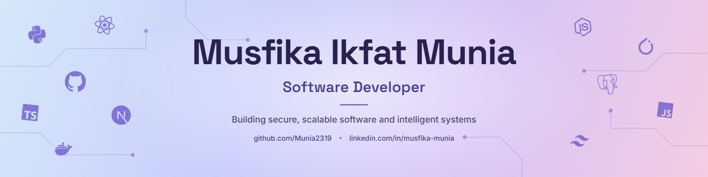

 

  <!-- PROFILE BANNER: ADD YOUR IMAGE LATER -->
 

  

 
# Hi, I'm Musfika Ikfat Munia 👋

### Software Developer | MSc in Software Cybersecurity

  

  
  

---

## 👩‍💻 About Me

I'm a software developer with a **Master's degree in Software Cybersecurity** from the Erasmus Mundus CYBERUS programme, jointly offered by the University of Luxembourg and Université Bretagne Sud.

My background combines software development, cybersecurity research and AI security. I've worked on adversarial machine learning, data poisoning, security analysis and full-stack web development.

I'm passionate about understanding how systems work, building secure applications and exploring the intersection of **AI, software engineering and cybersecurity**.

## 🌱 What I'm Working On

Building a stronger foundation in software engineering through hands-on development, real-world projects, and continuous learning.

## 🎯 Areas of Focus

`Backend Development` · `AI Engineering` · `AI Agent Security`

## 🛠️ Skills & Technologies

### Programming Languages

  

### Full-Stack Development

  

### Database Management

  

### AI & Machine Learning

  

### Cloud, DevOps & Infrastructure

  

### Security Tools & Technologies

  
  
  
  
  
  

## 🔬 Research & Professional Interests

Passionate about building intelligent and secure systems through software engineering and AI innovation.

---

  ### Let's Connect and Build Something Meaningful! 💙

  *Keep learning. Keep building. Keep securing.*

